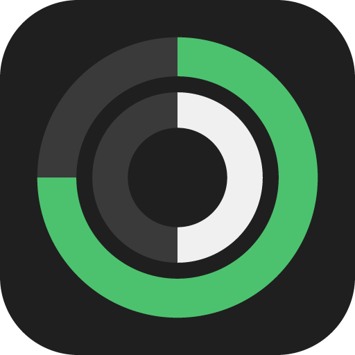
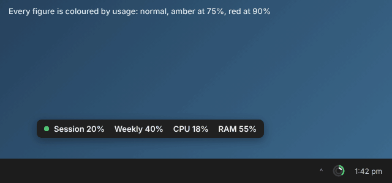
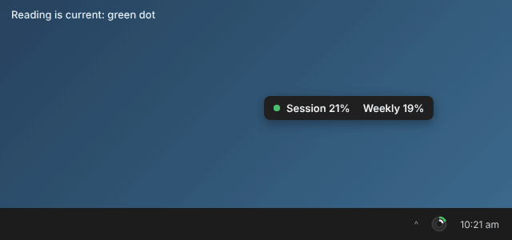
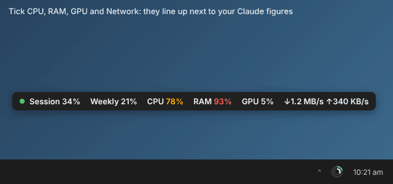

<p align="center"></p>

<h1 align="center">TokenStat</h1>

<p align="center"><b>Know your Claude limits before they find you.</b><br>
A tiny Windows tray app and floating pill that shows your Claude session and weekly usage at a glance.</p>

<p align="center"></p>

<p align="center"><a href="assets/demo/promo.mp4">Watch in full quality (MP4)</a></p>

You are deep in a refactor, Claude is flying, and then: limit reached. TokenStat puts your Claude usage on screen permanently, in a pill small enough to forget about until you need it.

## Why TokenStat

- **One glance, no context switch.** Session and weekly usage, plus reset times, without opening claude.ai or typing `/status`.
- **Warns before it hurts.** Each figure turns amber at 75% and red at 90%, so you can plan the big task or wait for the reset.
- **Honest numbers.** Figures come straight from Claude Code, with the time of the reading. When a reading is old, TokenStat says so and greys out. It never guesses.
- **Works how you work.** Terminal, VS Code's terminal, and the VS Code extension with opt-in auto-refresh.
- **Built to stay out of the way.** A single small native Rust exe. No browser engine, no background service, no polling while idle.
- **Private by design.** Local only, no telemetry, no account access. It keeps percentages and reset times, never your prompts.
- **Your shape, your stats.** Drag it wide for one line or narrow for a stack. Add CPU, RAM, GPU and network for a mini system monitor.
- **Free and open source.** MIT licensed.

TokenStat is an independent open-source project. It is not affiliated with or endorsed by Anthropic. Claude is a trademark of Anthropic.

## Use cases

**"Can I start this big task now?"**
Before kicking off a long agentic run or a large refactor, glance at the pill. Session at 82% and amber? Wait for the 2:10 pm reset, or switch to lighter work.

**"Why did Claude just stop?"**
No more surprise limits. The figure turns amber at 75% and red at 90%, and the tray icon rings fill up as you go, so you see it coming.

<p align="center"></p>

**"I live in VS Code."**
Use the Claude Code extension as normal. TokenStat notices and greys out the old reading. Turn on auto-refresh and fresh figures arrive within seconds.

<p align="center"></p>

**"I want one small widget, not five."**
Add CPU, RAM, GPU and network to the same pill. Drag the edge to make it a single line along the top of your screen or a compact stack in a corner. Hide labels for the smallest footprint.

<p align="center"></p>

<sub>Demos are animated illustrations of the real app's layout, colours and behaviour, not screen recordings. The promo is built with Remotion; source in [promo/](promo/).</sub>

## Features

- Draggable, always-on-top pill. Drag its left or right edge to choose the shape; items wrap into rows.
- Live tray icon: outer ring weekly, inner ring session, coloured by level, grey when the reading is old.
- Hover the tray icon for both percentages, reset times and when the reading was taken.
- Per-figure colour: amber from 75%, red from 90%, for Claude figures and system stats.
- Freshness: green dot when current, grey when older than 15 minutes or when Claude was used since.
- Optional system stats: CPU, RAM, GPU and network, each switched on separately.
- Light and dark mode, high contrast, per-monitor DPI.
- Right-click menu: Hide pill, Hide labels, Auto-refresh after VS Code use, System stats, Reset size, Start with Windows, Exit.

## How it gets the numbers

| Where you use Claude | How TokenStat sees it | Cost |
|---|---|---|
| Claude Code in a terminal (including VS Code's terminal) | Claude Code's documented [status line](https://code.claude.com/docs/en/statusline) passes the 5-hour and weekly `rate_limits` after each reply | None |
| Claude Code VS Code extension, claude.ai, desktop app | The extension does not run the status line. A Claude Code Stop hook tells TokenStat Claude was used, so the pill greys out with "Used since". | None |
| Same, with **Auto-refresh after VS Code use** on (opt-in) | TokenStat sends one tiny hidden Claude Code request (Haiku, `--safe-mode`, no tools), at most every 5 minutes, and reads the usage it reports | A small amount of your allowance per refresh |

Limits are shared across Claude surfaces, so every reading includes usage from all of them. Readings are whole percentages and can trail claude.ai by about 1 point.

Auto-refresh reads the `unifiedWindows` field of Claude Code's `rate_limit_event`. That field is not in the published Agent SDK types, so it could change. If it does, TokenStat shows the data as unavailable rather than wrong. Turning auto-refresh on shows this impact first, and the menu shows how many refreshes ran today and the tokens they used.

The `rate_limits` status line field is documented for Pro and Max plans. It has also been observed working on a Team plan seat.

## Requirements

- Windows 11 (Windows 10 likely works; untested)
- [Claude Code](https://code.claude.com) signed in with a Claude subscription
- To build: [Rust](https://rustup.rs) (MSVC toolchain) and Visual Studio Build Tools with the C++ workload

## Install

```powershell
git clone https://github.com/<you>/tokenstat.git
cd tokenstat
$env:CARGO_TARGET_DIR = "$env:LOCALAPPDATA\TokenStat-build"
cargo build --release
powershell -ExecutionPolicy Bypass -File .\scripts\install.ps1
```

The install script, per user and without admin rights:

- copies `tokenstat.exe` to `%LOCALAPPDATA%\Programs\TokenStat`
- backs up `%USERPROFILE%\.claude\settings.json`, then adds TokenStat's status line and Stop hook. An existing status line is kept: TokenStat runs it and shows its output.
- adds a Start menu shortcut and an entry in Settings > Apps
- starts TokenStat

Restart open Claude Code sessions afterwards so they pick up the new settings. Then find TokenStat in the Start menu, and tick **Start with Windows** in its menu if you want it every day.

## Uninstall

Settings > Apps > Installed apps > TokenStat > Uninstall, or run `scripts\uninstall.ps1`. This restores your original Claude Code status line, removes the hooks, the Start with Windows entry, the shortcut, the program and its data. Use `-KeepData` to keep settings.

## Privacy

- Local only. TokenStat makes no network connections and has no telemetry. With auto-refresh on, Claude Code itself makes the refresh request under your own login.
- From the status line input TokenStat keeps only the percentages, reset times and the time of the reading. It never stores prompts, session IDs, paths or transcripts.
- Files live in `%LOCALAPPDATA%\TokenStat`: `snapshot.json` (last reading), `activity.txt` (time Claude last replied), `settings.txt`, `pill.pos`, `refresh-stats.txt`.

## Resource budgets

| Area | Target |
|---|---|
| Idle CPU | about 0%; no periodic timers unless system stats are on |
| Memory | under 15 MB working set |
| Status line hook | under 100 ms per run |
| Network | none (auto-refresh runs Claude Code, which uses the network) |
| System stats | one sample every 2 s, only while a stat is on and the pill is visible |

These are targets. Measured results are recorded in [docs/TESTING.md](docs/TESTING.md).

## Limitations

- No absolute token counts: Anthropic exposes percentages only.
- No Fable weekly bar: Claude Code's status line does not include it.
- Without auto-refresh, usage outside terminal Claude Code shows only as "Used since" until the next terminal reply.
- The exe is unsigned, so Windows SmartScreen may warn on first run.

## Docs

- [Architecture and security review](docs/ARCHITECTURE.md)
- [Decisions](docs/DECISIONS.md)
- [Data source feasibility](docs/FEASIBILITY.md)
- [Testing](docs/TESTING.md)

## Licence

[MIT](LICENSE) © 2026 Abi Chaudhuri
